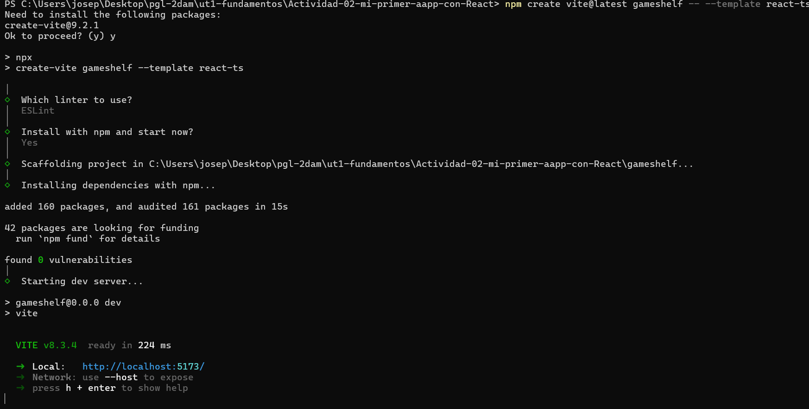
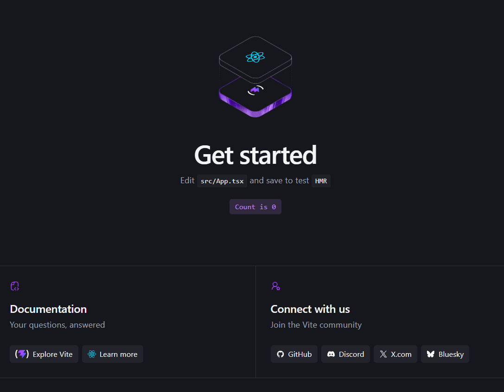
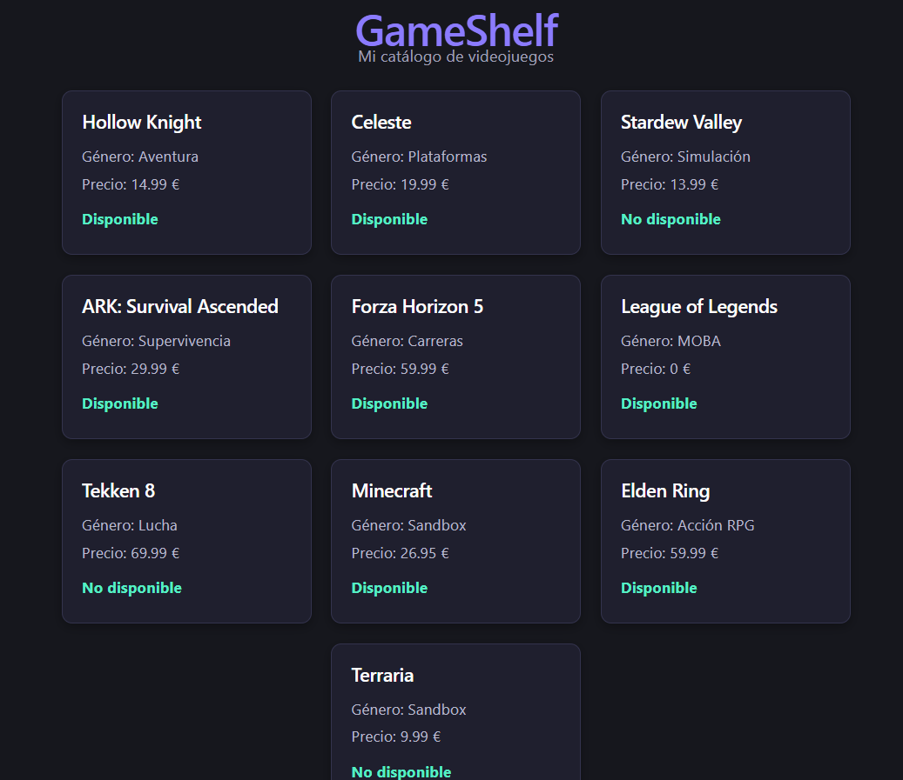
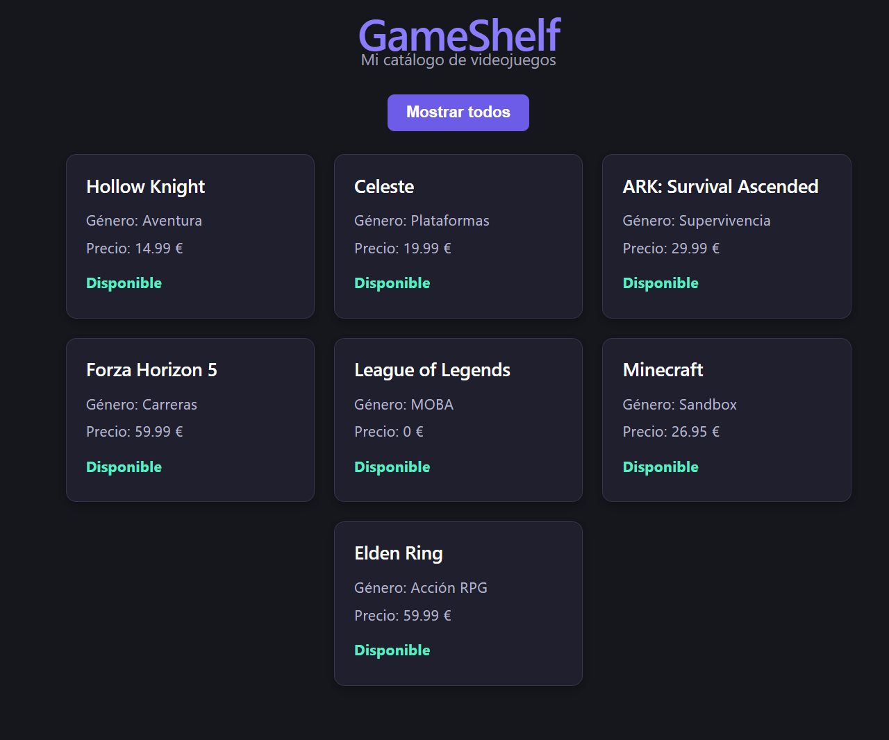

# GameShelf — Catálogo de Videojuegos

## 🛠️ Herramientas y Ejecución

**Herramientas utilizadas:** React, Vite, TypeScript

**Cómo ejecutar este proyecto en tu ordenador:**
1. Instalar las dependencias con: `npm install`
2. Arrancar el servidor de desarrollo con: `npm run dev`

## 🔍 Investigación de Herramientas (Sesión 1)

* **¿Qué es React? ¿Es un lenguaje, una biblioteca o una herramienta para crear proyectos?**
  * React es una biblioteca de JavaScript para crear la parte de frontend de una página web. (Fuente: [Enlace](https://tripleten.mx/blog/que-es-react-y-para-que-sirve/))
* **¿Qué diferencia hay entre create-vite y Vite? ¿Qué hace Vite mientras ejecutamos npm run dev? ¿Qué crees que hará npm run build?**
  * Vite es la herramienta de construcción, mientras que create-vite es el asistente que genera la estructura del proyecto. Lo que Vite hace cuando ejecutamos `npm run dev` es compilar los archivos, y cuando haces `npm run build`, Vite hace el empaquetado, limpia y comprime todo el código. (Fuente: [Enlace](https://es.vite.dev/guide/))
* **¿Qué son Node.js y npm? ¿Para qué usamos npm create, npm install y npm run dev?**
  * Node.js es un entorno de ejecución de JavaScript. Utilizamos npm para gestionar, instalar y descargar código. El comando `npm create` sirve para crear un proyecto, `npm install` para instalar los paquetes de package.json y `npm run dev` para desplegar la aplicación en un entorno de desarrollo. (Fuente: [Enlace](https://learn.microsoft.com/es-es/windows/dev-environment/javascript/nodejs-overview))
* **¿Qué son las dependencias? ¿Por qué aparece node_modules?**
  * Las dependencias son las bibliotecas que el proyecto necesita y son almacenadas en node_modules. (Fuente: [Enlace](https://www.luisllamas.es/que-es-carpeta-node-modules-de-npm/))
* **¿Qué añade TypeScript a JavaScript?**
  * TypeScript añade tipado al código de JavaScript.
* **¿Qué significan JSX y TSX?**
  * Son extensiones utilizadas por React para escribir componentes: una es para código TypeScript y la otra para código JavaScript.

### Análisis de Archivos

| Archivo/carpeta | Pregunta | Respuesta |
|---|---|---|
| `index.html` | ¿Qué elemento tiene id="root"? | El elemento que tiene el root es el div y actúa como contenedor vacío donde React transfiere y renderiza la aplicación. |
| `src/main.tsx` | ¿Qué componente importa? ¿Dónde aparece createRoot? | Lo que importa es el componente App, y createRoot aparece dentro del root como un elemento. |
| `src/App.tsx` | ¿Qué interfaz se muestra? | El código por defecto que generó React al iniciarse la aplicación. |
| `src/index.css` | ¿En qué se diferencia de App.css? | index.css tiene los estilos globales de la página. |
| `package.json` | ¿Qué comandos aparecen en scripts? | Los comandos que aparecen en el package.json son dev y build. |
| `tsconfig.json` | ¿Qué indica "ts"? ¿Necesitas editarlo hoy? | Que es un archivo de TypeScript y no necesito configurarlo porque ya viene configurado. |
| `vite.config.ts` | ¿Qué nombre de herramienta aparece? | Aparece el nombre de la herramienta React para que Vite pueda entender y procesar código TSX y JSX. |
| `public/` y `src/assets/` | ¿Qué recursos encuentras? | En public y en assets se encuentran imágenes SVG. |
| `node_modules/` | ¿Qué contiene? ¿Por qué no se sube? | El node_modules contiene las dependencias del proyecto y no se sube porque es muy pesado. |
| `.gitignore` | ¿Qué archivos o carpetas ignora Git? | Ignora node_modules, dist y .env. |

**Preguntas adicionales sobre archivos:**

* **¿Qué archivo contiene el punto de entrada HTML?**
  * Contiene la estructura base de un HTML y un div con el id root.
* **¿Qué archivo carga App?**
  * El archivo que carga App es main.tsx.
* **¿Cuál es el componente principal?**
  * Mi componente principal es App.tsx.
* **¿Qué hace el script dev?**
  * Levanta el servidor de desarrollo.
* **¿Qué significa la extensión .tsx?**
  * Que el archivo utiliza TypeScript.

## 📖 Glosario de Conceptos

| Concepto | Definición propia | Fuente consultada |
|---|---|---|
| Componente | Una pieza de código reutilizable que está escrita como una función y se usa como una etiqueta HTML. | [Enlace](https://react.dev/learn/your-first-component) |
| Props | Datos que el componente recibe. | [Enlace](https://react.dev/learn/passing-props-to-a-component) |
| Función | Un bloque de código donde se realiza una tarea. | [Enlace](https://developer.mozilla.org/es/docs/Web/JavaScript/Guide/Functions) |
| Parámetro | Es un valor que una función puede recibir. | [Enlace](https://developer.mozilla.org/en-US/docs/Glossary/Parameter) |
| Función flecha | Sintaxis corta para escribir funciones. | [Enlace](https://developer.mozilla.org/es/docs/Web/JavaScript/Reference/Functions/Arrow_functions) |
| Evento | Lo que pasa cuando el usuario hace algo, como hacer clic o pasar por la página; el código lo captura. | [Enlace](https://react.dev/learn/responding-to-events) |
| Manejador | Función que se ejecuta cuando ocurre un evento. | [Enlace](https://react.dev/learn/responding-to-events) |
| Estado | Datos que un componente guarda y que, al cambiar, hacen que se vuelva a renderizar. | [Enlace](https://react.dev/learn/state-a-components-memory) |
| Callback | Función que se le pasa a otra para que se ejecute más tarde. | [Enlace](https://developer.mozilla.org/es/docs/Glossary/Callback_function) |
| map() | Método de array que aplica una función a cada elemento y devuelve un array nuevo con los resultados. | |
| filter() | Método de array que recoge los valores que cumplan una condición. | [Enlace](https://developer.mozilla.org/es/docs/Web/JavaScript/Reference/Global_Objects/Array/filter) |

## 🎨 Diseño y Estilos CSS (Sesión 2)

* **¿Dónde escribiste los estilos y cómo los relacionaste con className?**
  * Escribí los estilos en `App.css` y lo importé en el componente con `import './App.css'`. En JSX uso `className` (en vez de `class`, que es palabra reservada de JavaScript) para enlazar cada elemento con su regla: `
`, `
` y `
` se corresponden con `.app`, `.catalog` y `.card` del CSS.

**Sobre el catálogo:**

* **¿Cómo elegiste los datos de tus juegos adicionales?**
  * Elegí juegos que conozco y que me gustan, y mantuve la misma estructura de objeto que los juegos de ejemplo (mismas propiedades: título, género, plataforma, precio, etc.) para que `map()` pudiera pintarlos todos igual con la misma tarjeta.
* **¿Qué recibe el parámetro `game` en cada vuelta del map() y qué devuelve la función flecha?**
  * En cada vuelta `game` recibe un objeto del array, es decir, un juego distinto cada vez.

## ⚙️ Interactividad y Filtros (Sesión 3)

* **Diferencia entre definir una función y llamarla:**
  * Definir la función es escribir el bloque de código, y llamarla es pedir que la función se ejecute.
* **Diferencia entre estado (useState) y una variable normal:**
  * Una variable normal puede cambiar de valor, pero la página no se actualiza dinámicamente; con useState, la página se actualiza cuando el valor cambia.
* **¿Qué hace la propiedad onClick?**
  * Cuando le hacen clic al botón, ejecuta la función.
* **¿Qué hace exactamente el código `() => setOnlyAvailable(!onlyAvailable)`?**
  * Es una función flecha que invierte el valor de onlyAvailable: si es true lo cambia a false, y viceversa.
* **Funcionamiento de `useState` (valor actual y función actualizadora):**
  * useState empieza con false cuando es declarado y devuelve el valor actual cuando llamamos a onlyAvailable; setOnlyAvailable sirve para actualizarlo.

### Reto Final: Filtro de Precio (< 15€)

* **¿Cómo funciona este filtro y cómo se combina con el de disponibilidad?**
  * El filtro coge la lógica anterior y pregunta si el juego cumple las 2 condiciones.

## 📝 Entrega y Reflexión Final

1. **¿Qué archivo conecta el HTML con App?**
   * main.tsx
2. **¿Qué diferencias hay entre React, TypeScript y Vite?**
   * React es una librería de interfaz gráfica, TypeScript es el lenguaje de programación y Vite es una herramienta de entorno.
3. **¿Qué son las props de GameCard?**
   * Los parámetros que van dentro de la tarjeta.
4. **¿Por qué usamos setOnlyAvailable para cambiar el estado?**
   * Para que el cambio se vea en la página.
5. **¿Qué hacen map() y filter()?**
   * map() recorre una lista y filter() filtra basándose en una condición.
6. **¿Para qué sirve key?**
   * Es un identificador único que React exige al renderizar elementos en una lista.

