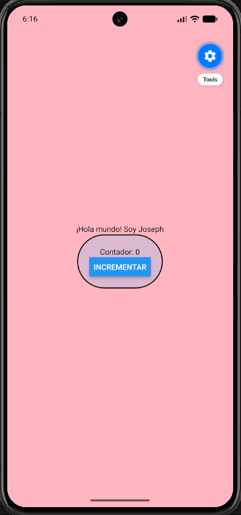
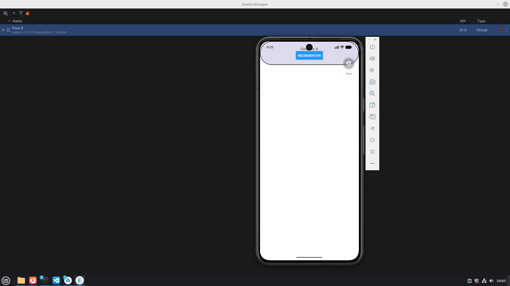
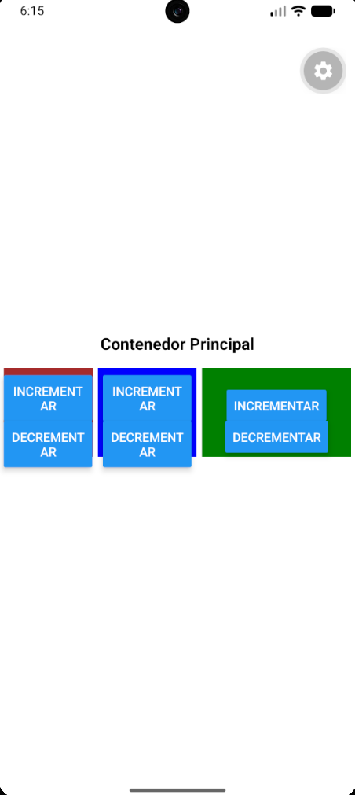
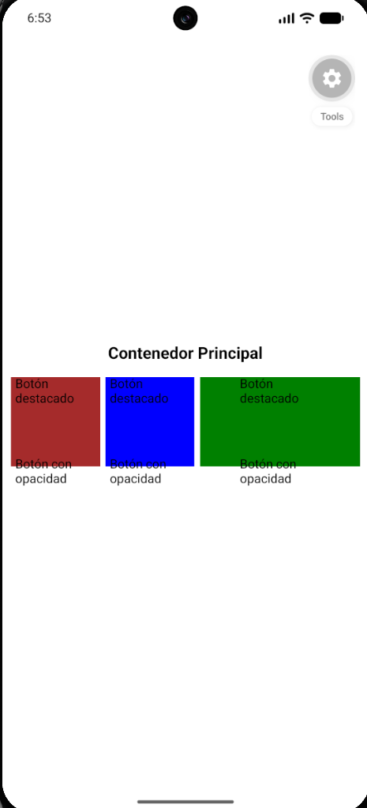
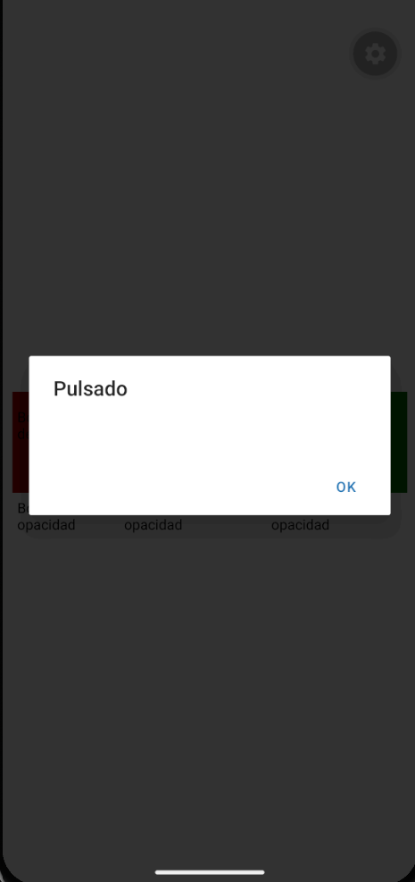
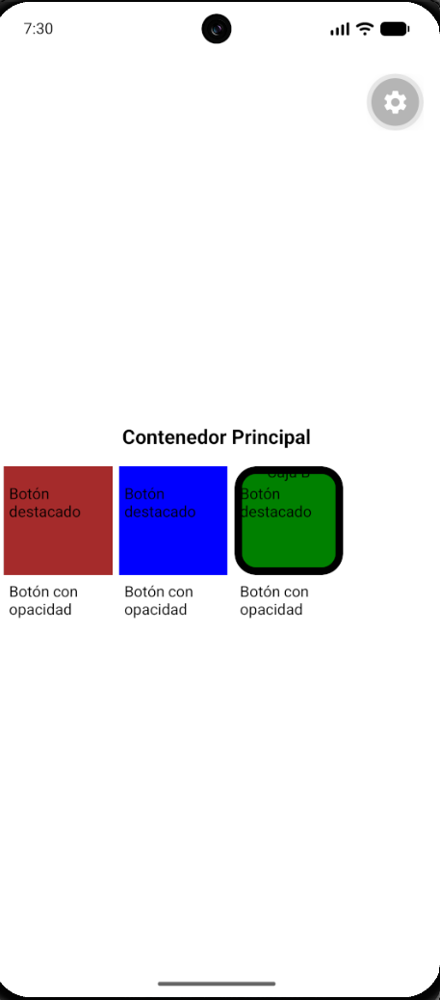
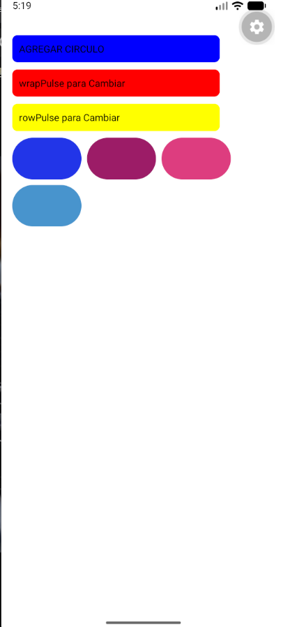
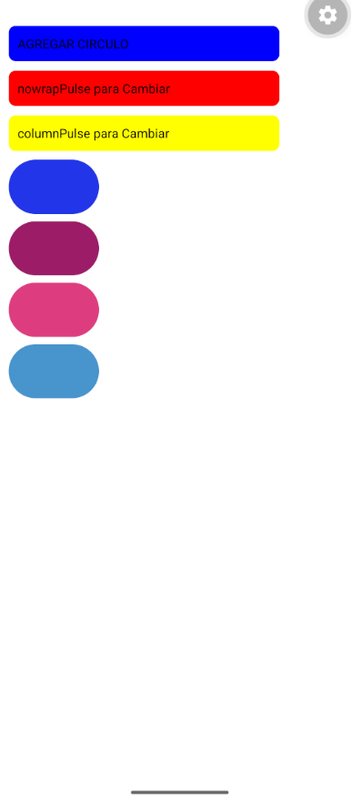

# Dossier de React Native con Expo — Hoja de respuestas

---

## Práctica 1. Hola mundo
**Captura:** pantalla rosa con «¡Hola mundo! Soy [nombre]».


## Práctica 2. Contador con dos botones
**Captura:** contador con borde, fondo y esquinas redondeadas, con los botones de incrementar y decrementar (idealmente con un valor distinto de 0).



## Práctica 3. `InicioScreen` y estilos separados
**Captura:** el contador funcionando desde `<InicioScreen />`.



## Práctica 4. Tres cajas
**Captura:** `PrincipalScreen` con el texto «Contenedor Principal» y las tres cajas de 100 × 100 de colores distintos.


## Práctica 5. Modificar `flex` dinámicamente
**Captura:** las cajas con valores de `flex` distintos y el valor visible en cada una.
```tsx
import { useState } from "react";
import { Button, StyleSheet, Text, View } from "react-native";

type Props = { nombre: string; bg?: string };
export default function Caja({ nombre, bg = "green" }: Props) {
    const [valorFlex, setValorFlex] = useState(0);
    return (
        <View style={[styles.caja, { backgroundColor: bg , flex: valorFlex }]}>
            <Text>{nombre}</Text>
            <Button title="Incrementar" onPress={() => setValorFlex((n) => n + 1)}/>
            <Button title="Decrementar" onPress={() => setValorFlex((n) => n - 1)}/>
        </View>
    );
}
const styles = StyleSheet.create({
    caja: {
        height: 100,
        width: 100,
        justifyContent: "center",
        alignItems: "center",
        
    },
});


```


## Práctica 6. Sustituir los botones
**Captura 1:** las cajas con `TouchableHighlight` (+) y `TouchableOpacity` (−).
**Captura 2:** la alerta que aparece al pulsar `flex + 1`.




## Práctica 7. Nombre y estilos personalizados
**Captura:** cajas A, B y C con nombre visible y al menos una con borde y esquinas redondeadas.



## Práctica 8. Círculos dinámicos
**Captura 1:** varios círculos de colores en modo `row` + `wrap`.
**Captura 2:** los mismos círculos en modo `column` y/o `nowrap`.



